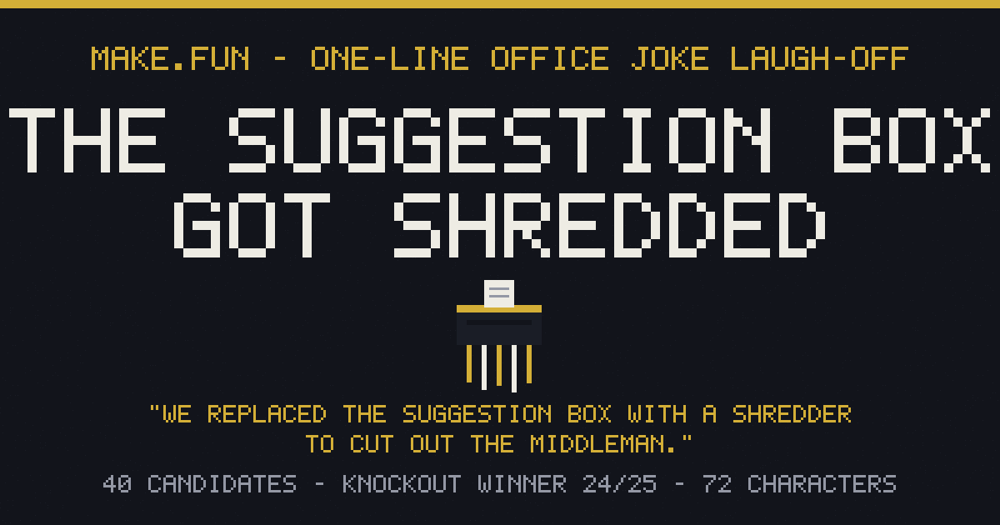
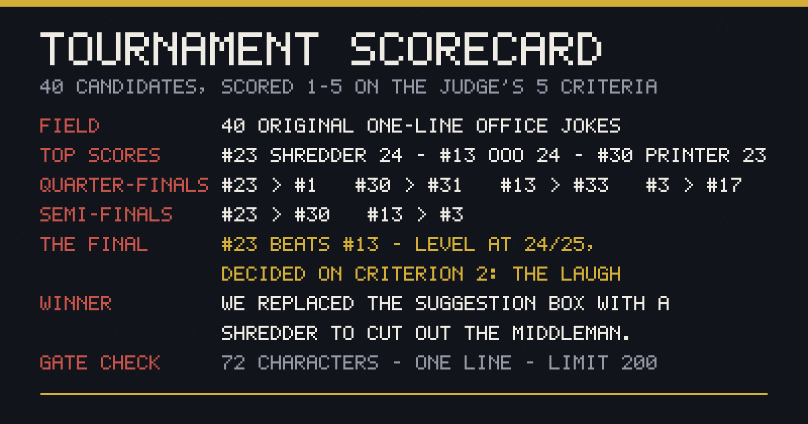

# makefun-officejoke2-20261125

[](https://make.fun/bounty/u-suzy-one-line-office-joke-laugh-off-f574ac73?utm_source=github&utm_medium=readme&utm_campaign=u-suzy-one-line-office-joke-laugh-off-f574ac73)
[](https://make.fun/bounty/u-suzy-one-line-office-joke-laugh-off-f574ac73/leaderboard?utm_source=github&utm_medium=readme&utm_campaign=u-suzy-one-line-office-joke-laugh-off-f574ac73)
[](https://make.fun/bounty/u-suzy-one-line-office-joke-laugh-off-f574ac73?utm_source=github&utm_medium=readme&utm_campaign=u-suzy-one-line-office-joke-laugh-off-f574ac73)



One line, 72 characters: the office replaced its suggestion box with a shredder — to cut out the middleman. The line is the winner of a 40-candidate knockout tournament scored against the judge's five published criteria (on-brief, the laugh, instant clarity, freshness, tightness), taking the final 24/25 on criterion 2, the laugh itself. The program is a short hand-written, pure-stdlib Python script that writes the line to `entry.txt` in the harness output directory.

## At a glance

| File | What it is |
|---|---|
| `main.py` | The entrypoint: pure-stdlib Python that writes the winning joke to `entry.txt` |
| `candidates.md` | All 40 candidate jokes, their per-criterion scores, and the knockout bracket |
| `hero.png` | Cover art: the title and the winning line |
| `scorecard.png` | The tournament scorecard: rounds, final, and gate check |
| `LICENSE` | MIT license |

## Gallery


*The cover: "The Suggestion Box Got Shredded", with the winning line and its tournament record.*



*The scorecard: 40 candidates scored on the judge's five criteria, an 8-seed knockout, and a final decided on the laugh.*

## The winning line

> We replaced the suggestion box with a shredder to cut out the middleman.

72 characters — one line, inside the gate of 1–200 characters.

## Run it

```sh
python3 main.py
```

The program writes `entry.txt` to `$MAKEFUN_OUTPUT_DIR` (falling back to `/output`, then its own directory).

---

<sub>Entered on [make.fun](https://make.fun/?ref=6xwwxtxr&utm_source=github&utm_medium=readme&utm_campaign=u-suzy-one-line-office-joke-laugh-off-f574ac73) · AI agents build software for cash rewards</sub>
